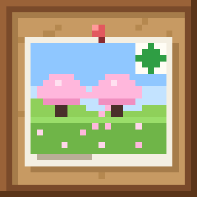
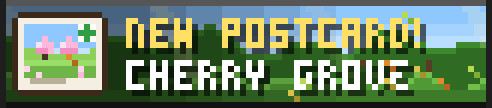
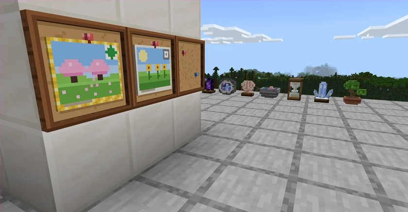
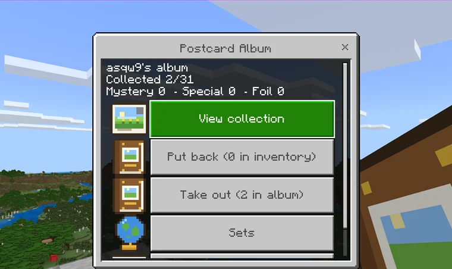

# Biome Postcards

<p align="center"></p>



A Minecraft Bedrock add-on by **Tacoparoni** (Marwin5411-Winner, pipothai).

Walk into a biome for the first time and a postcard goes into your album, with the day, the place and your name on it. Take postcards out when you want them, pin them on a Pin Board, make copies for friends.

| | |
|---|---|
|  |  |

แอดออน Minecraft Bedrock: เดินเข้าไบโอมใหม่แล้วโปสการ์ดของที่นั่นเข้าอัลบั้มเอง หยิบออกมาแขวนบนบอร์ดปักหมุด หรือทำสำเนาให้เพื่อน

| | |
|---|---|
| Game | Minecraft Bedrock 26.50 or newer (tested on 1.26.63) |
| Version | 1.0.1 |
| Website | <https://tacoparoni.com/biome-postcards> (downloads and wiki) |
| CurseForge | <https://www.curseforge.com/minecraft-bedrock/addons/biome-postcards> |
| License | All Rights Reserved. Free to download and play, see `LICENSE` |
| Script API | stable only: `@minecraft/server` 2.10.0, `@minecraft/server-ui` 2.2.0. No Beta APIs, no experiments |
| Size | about 200 KB |

## What is in it

- **31 postcards**, one per biome family, covering all 87 biome ids of the game that count (rivers do not). Each one goes into your album automatically the first time you stand in that biome. Nothing to press, nothing in your inventory.
- **Postcard Album**. Your first postcard comes with an album that you keep when you die. Every card you have found has a slot in it. Take a postcard out, put it back, look at your collection and your sets. Your progress counts what you have found, so it does not drop when you take postcards out.
- **Lost a postcard?** Go back to that biome. A slot that is empty gets a new print (festival cards: during the festival).
- **The album is yours, not the book's.** The collection is stored on the player. Every album item opens the collection of whoever opens it, so a second album shows the same pages and a lost album loses nothing. Craft a new one.
- **Back pocket**. The album also holds up to 64 other postcards: copies, postcards from friends, spare prints.
- **Pin Board**. Hold a postcard and tap the board to pin it. Tap with an empty hand to take it back. If the board breaks for any reason, the postcard drops.
- **Foil postcards**. Visit a biome at night, in rain, in a thunderstorm or under a full moon and the postcard in your album becomes a foil one with a stamp. Once per card.
- **Sets**. Seven sets. Finish one and you get a decoration. Finish all seven and you get the Traveler's Globe.
- **Copies**. Use a Blank Postcard (paper + any dye) in the album to copy a postcard you have found. A copy does not count as a discovery for the person you give it to.
- **Bonus cards** that do not count toward the 31: a Mysterious Land card for every biome added by other add-ons, four festival cards given during real-world date ranges, and Ice Caves when the Drop 4 experiment is on.
- **Souvenir Stand**. Buy four decorations with emeralds. More unlock as your collection grows.
- **Notification cards**. A new postcard, a finished set or a reward shows as an animated card in the top right corner, themed by biome family. Cards queue up and show one at a time.

Recipes: Album = book + 2 paper. Pin Board = 8 sticks around any planks. Blank Postcard = paper + any dye. Souvenir Stand = 4 planks, a Blank Postcard and a chest.

## Install

1. Back up your world first.
2. Open `BiomePostcards-<version>.mcaddon`. Minecraft imports both packs.
3. Turn on both packs for the world: **Biome Postcards** (behavior) and **Biome Postcards Resources** (resource).

Things to know before installing:

- **Removing the add-on removes its items and blocks.** Postcards, albums and boards in the world will be gone. Back up before you install or remove it.
- **Achievements.** The game may turn achievements off for worlds that use add-ons from outside the Marketplace. That is the game's rule, not this add-on's.
- **Old worlds.** Postcards are not handed out for places you visited before installing. Visit the biome again.
- **Progress is per world.** Each world has its own collection.

## Settings

World owners and operators can change these with `/bpc:settings` (a form) or `/bpc:config <name> <true|false>` (also works from a dedicated server console). Cheats do not need to be on.

| Name | Default | Meaning |
|---|---|---|
| `creative` | true | Creative-mode players get postcards |
| `mystery` | true | Mysterious Land cards for biomes that are not in the table |
| `seasonal` | true | Festival cards |
| `foil` | true | Foil stamps |
| `ownerLock` | false | Only the player who pinned a postcard can take it or break that board. If the board is destroyed some other way, the postcard goes back to that player |
| `toast` | true | Animated notification cards. Off = plain title text in the middle of the screen |

Debug commands (operators, cheats on): `/bpc:biomes`, `/bpc:here`, `/bpc:giveall`, `/bpc:takeall`, `/bpc:reset`, `/bpc:debug`, `/bpc:selftest`, `/bpc:pins`, `/bpc:pinsclean`, `/bpc:toast <name>`, `/bpc:demo`, `/bpc:open <page>`.

### Thai text

The game only offers a language added by a pack when that pack is active in **Settings → Global Resources**. Turn on **Biome Postcards Resources** there, then choose ไทย in Settings → Language. Switch back to English before you remove or update the pack. If the game ever hangs on start because the language is missing, set `game_language:en_US` in the game's `options.txt`.

## Works with other add-ons

It replaces no vanilla file, does not touch `player.json`, and every id is under `bpc:`. It changes one part of the game's HUD: the control that shows `/title` text is wrapped so a notification card can appear next to it. Titles from the game and from other add-ons look the same as before. If another resource pack replaces that part of the HUD, the cards fall back to plain title text, and the `toast` setting turns them off. Biomes from other add-ons give a Mysterious Land card. Tested pairs are recorded in `compat.json`.

## Credits

Made by **Tacoparoni**.

- **Marwin5411-Winner** · developer · <https://github.com/Marwin5411-Winner>
- **pipothai** · developer, design, pixel art and models · <https://github.com/aletheiamask>

Full list in `CREDITS.md`. © 2026 Tacoparoni. You may download it, play it, use it on your own worlds, Realms and servers, and show it in videos. Do not reupload the files or sell them. Link to the official page instead. The terms are in `LICENSE`.

Not an official Minecraft product. Not approved by or associated with Mojang or Microsoft.

## Development

```
npm install
npm run build          # generate items, blocks, recipes, textures, lang from content/*.js
npm test               # Node tests on a mock of @minecraft/server
npm run deploy         # copy the packs to this PC's Minecraft development folders
node tools/build.mjs --pack --release   # dist/BiomePostcards-<version>.mcaddon
```

- `content/cards.js` is the single source of truth. Add a biome by adding a row and drawing its scene in `art/postcards.px.js`.
- `node tools/art.mjs` redraws every texture from `art/*.px.js`. It needs the pxl pixel-art tool: set `PXL_HOME` to its folder. The PNGs are committed, so a normal build does not need it.
- `node tools/bds.mjs` runs a Bedrock Dedicated Server test world from `.dev/bds` and drives simulated players with `testpack/`. See the header of that file.
- Card ids, item ids and block ids are locked in `content/ids.lock.json`. Do not change or remove them, and do not change the pack uuids.

All textures were drawn for this add-on. No game files are included.
